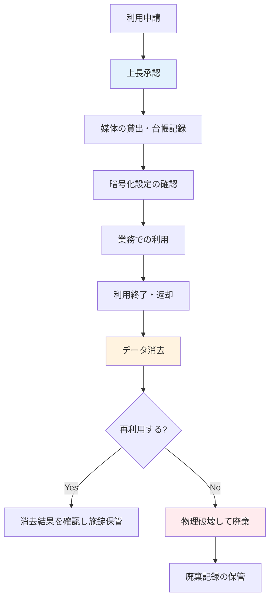

# A.7.10 記憶媒体

## 管理策の概要

| 項目 | 内容 |
|------|------|
| 管理策タイプ | 予防的 |
| 情報セキュリティ特性 | 機密性、完全性、可用性 |
| サイバーセキュリティ概念 | 防御 |
| 運用能力 | 物理的セキュリティ、資産管理 |
| セキュリティドメイン | 保護 |

## 目的

記憶媒体を、組織の分類体系と取扱い要件に従って、取得から利用、輸送、廃棄までのライフサイクル全体で管理します。USB メモリや外付けディスクなどの記憶媒体は、小型で持ち運びが容易なため、紛失・盗難による情報漏洩のリスクが特に高い資産です。媒体の管理ルールを明確にすることで、保存された情報の漏洩・改ざん・喪失を防ぎます。

## 実施のポイント

### 管理対象となる記憶媒体

管理対象とする媒体の範囲を明確に定義します。代表的な対象は以下のとおりです。

- USB メモリ・SD カード等のリムーバブルメディア
- 外付け HDD / SSD
- CD / DVD / Blu-ray 等の光学メディア
- バックアップ用磁気テープ
- PC・サーバー・複合機等に内蔵されたディスク（廃棄・再利用時）

そもそも記憶媒体を使わずに済む業務フロー（許可されたクラウドストレージでの共有など）へ移行することも、リスクを減らす有効な手段です。媒体の利用は業務上の必要性がある場合に限定します。

### ライフサイクル全体での管理

媒体は次の各段階で一貫して管理します。

| 段階 | 主な管理策 |
|------|------------|
| 取得・登録 | 会社が調達した媒体のみ使用、管理台帳への登録、管理番号ラベルの貼付 |
| 利用 | 利用申請・承認、暗号化の必須化、私物媒体の使用禁止 |
| 保管 | 施錠可能なキャビネットでの保管、保管場所と責任者の明確化 |
| 輸送 | 暗号化、施錠ケースの使用、受け渡し記録の作成 |
| 再利用 | 復元不可能な方式でのデータ消去、消去結果の確認・記録 |
| 廃棄 | 物理破壊または確実な消去、廃棄記録（証明書）の保管 |

保存する情報の機密レベルに応じて、暗号化の要否や保管・輸送方法などの取扱い基準を変えます。媒体には情報の分類が分かるラベル付けを行います。

### 媒体の利用・返却フロー



### 輸送時の保護

媒体を拠点間や社外へ輸送する際は、以下の対策を講じます。

1. **暗号化**: 輸送する媒体内のデータは必ず暗号化する
2. **物理的保護**: 施錠可能なケース・封緘可能な封筒を使用する
3. **信頼できる輸送手段**: 信頼できる配送業者の利用、または担当者による手渡し
4. **受け渡し記録**: 発送者・受領者・日時・媒体の管理番号を記録する
5. **受領確認**: 到着後に受領者が内容を確認し、発送者へ連絡する

### 再利用・廃棄時のデータ消去

媒体を再利用または廃棄する際は、保存されていた情報が復元できない状態にします。「ごみ箱を空にする」「フォーマットする」だけでは、データが復元できる場合があるため不十分です。

| 方式 | 概要 | 適用場面 |
|------|------|----------|
| 上書き消去 | 専用ソフトウェアで全領域にデータを上書き | HDD・USB メモリの再利用 |
| 暗号化消去 | 暗号化済み媒体の暗号鍵を破棄 | 暗号化を徹底している媒体 |
| 磁気消去 | 強磁気で記録を破壊（媒体は再利用不可） | 磁気テープ・HDD の廃棄 |
| 物理破壊 | 裁断・破砕・穿孔により媒体自体を破壊 | 廃棄全般、消去不能な媒体 |

外部の廃棄業者に委託する場合は、破壊・消去の完了を証明する書類（廃棄証明書）を受領し、保管します。

## 実装例

### 記憶媒体管理規則（例）

```yaml
記憶媒体管理規則:

  利用条件:
    許可媒体: 会社が貸与する暗号化機能付き USB メモリのみ
    私物媒体: 使用禁止
    申請: 利用前に上長の承認を得る
    台帳: 総務部が管理台帳で貸出・返却を管理

  取扱い基準:
    極秘情報: 媒体への保存禁止（クラウドの専用領域のみ）
    秘密情報: 暗号化必須、構外持出しは別途申請
    社外秘情報: 暗号化必須
    公開情報: 制限なし

  保管:
    場所: 総務部の施錠キャビネット
    棚卸: 半期に1回、台帳と現物を照合

  紛失時:
    報告先: 上長および ISMS 管理責任者へ直ちに報告
    対応: インシデント対応手順に従う

  再利用・廃棄:
    再利用: 専用ソフトで上書き消去し、消去結果を記録
    廃棄: 物理破壊（委託時は廃棄証明書を受領・保管）
```

### 記憶媒体管理台帳テンプレート

| 管理番号 | 種類 | 機密レベル | 利用者 | 貸出日 | 返却日 | 状態 |
|----------|------|------------|--------|--------|--------|------|
| USB-0045 | USB メモリ（暗号化） | 秘密 | 山田太郎 | 2025-01-27 | 2025-01-27 | 保管中 |
| USB-0046 | USB メモリ（暗号化） | 社外秘 | 鈴木一郎 | 2025-01-28 | - | 貸出中 |
| HDD-0012 | 外付け HDD | 秘密 | - | - | - | 廃棄済（2025-01-20） |

### 記憶媒体利用申請（例）

```yaml
記憶媒体利用申請:

  申請者情報:
    氏名: 山田太郎
    所属: インフラ部
    社員番号: EMP001

  利用情報:
    媒体: USB メモリ（管理番号: USB-0045）
    利用期間: 2025-01-27（当日返却）
    利用目的: サーバー定期メンテナンス用ツールの持込み
    保存する情報: メンテナンス用スクリプト（社外秘）
    構外持出し: なし

  承認:
    上長: 佐藤部長（承認済）
    台帳記録: 田中（総務部・記録済）

  返却時確認:
    データ消去: 実施済（上書き消去）
    消去確認者: 鈴木一郎
```

### データ消去・廃棄記録テンプレート

| 項目 | 記録内容 |
|------|----------|
| 実施日 | 2025-01-20 |
| 対象媒体 | 外付け HDD（管理番号: HDD-0012） |
| 処理区分 | 廃棄 |
| 処理方法 | 物理破壊（廃棄業者委託） |
| 証明書 | 廃棄証明書 受領済（証跡番号: CERT-2025-003） |
| 実施者 | 田中（総務部） |
| 確認者 | 佐藤部長 |

## 関連する管理策

- [A.5.9 情報およびその他の関連資産の目録](/controls/#a-5-9) - 媒体の資産目録への登録
- [A.5.12 情報の分類](/controls/#a-5-12) - 分類に応じた取扱い基準の設定
- [A.5.13 情報のラベル付け](/controls/#a-5-13) - 媒体への分類ラベルの貼付
- [A.7.14 装置のセキュリティを保った処分又は再利用](/controls/a-7-14) - 内蔵ディスクを含む装置の処分・再利用
- [A.8.10 情報の削除](/controls/a-8-10) - 不要となった情報の確実な削除

## 参考情報

- [従業員向けセキュリティガイドライン - 4.6 記憶媒体の取扱い](/isms/guidelines/employee-security-guideline#_4-6-記憶媒体の取扱い-a-7-10) - 従業員向けの具体的なルール
- [仮想組織の設定 - 機密レベル定義](/templates/virtual-organization#機密レベル定義) - 取扱い基準の前提となる分類
