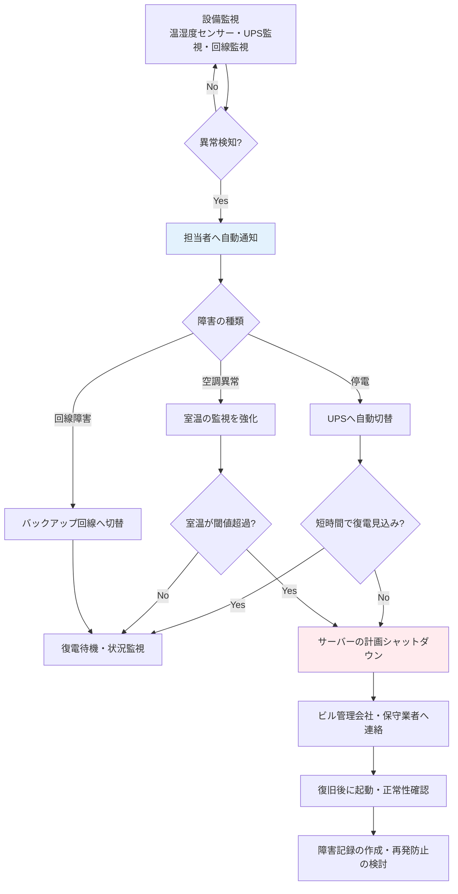

# A.7.11 サポートユーティリティ

## 管理策の概要

| 項目 | 内容 |
|------|------|
| 管理策タイプ | 予防的・検知的 |
| 情報セキュリティ特性 | 完全性、可用性 |
| サイバーセキュリティ概念 | 防御・検知 |
| 運用能力 | 物理的セキュリティ |
| セキュリティドメイン | 保護 |

## 目的

情報処理設備を、電源障害やサポートユーティリティの障害から保護します。電源・空調・通信回線などのユーティリティが停止すると、サーバーの異常停止によるデータ破損や、サービス停止による業務中断が発生します。ユーティリティの冗長化・監視・定期点検により、障害の予防と早期検知を実現します。

## 実施のポイント

### 対象となるユーティリティの特定

情報処理設備を支えるユーティリティを洗い出し、障害時の影響を評価します。

| ユーティリティ | 障害時の主な影響 | 主な対策 |
|----------------|------------------|----------|
| 電源 | サーバー異常停止、データ破損 | UPS、非常用発電機、サージ保護 |
| 空調・換気 | 機器の過熱による故障・停止 | 空調の冗長化、温湿度監視 |
| 通信回線 | サービス・業務システムの利用不能 | 回線の二重化、キャリア分散 |
| 給水・排水 | 空調停止（水冷式の場合）、漏水被害 | 設置場所の選定、漏水検知 |
| 消防・防災設備 | 火災時の被害拡大 | 法定点検、火災報知機との連動 |

賃借ビルに入居している場合は、受電設備や非常用発電機などビル側で管理される設備も多いため、自社の管理範囲とビル管理会社の管理範囲を契約・覚書で明確にしておきます。

### 電源障害への段階的な備え

停電の継続時間に応じて、対策を段階的に設計します。

| 障害の規模 | 想定される状況 | 対策 |
|------------|----------------|------|
| 瞬断・電圧変動 | 落雷、系統切替 | UPS・サージプロテクタで吸収 |
| 短時間の停電（〜30分） | ビル設備の不具合 | UPSで稼働を継続し、復電を待機 |
| 長時間の停電（30分〜） | 地域停電、災害 | UPS稼働中にサーバーを計画シャットダウン |
| 広域・長期の障害 | 大規模災害 | 事業継続計画に基づきDR環境へ切替 |

UPSは「停電中も動かし続ける」ためではなく、「安全にシャットダウンする時間を確保する」ための装置と位置づけ、必要なバックアップ時間から容量を決定します。

### 障害の検知と対応フロー

ユーティリティの異常を早期に検知できるよう、監視とアラート通知を整備します。



### 定期点検と保守

ユーティリティ設備は、導入して終わりではなく、定期的な点検で機能を維持します。

- **UPS**: バッテリーは消耗品のため、定期点検と寿命に応じた交換計画を立てる
- **空調**: フィルター清掃・冷媒点検を定期的に実施する
- **非常用電源**: ビル側設備の場合は、ビル管理会社の点検結果を入手・確認する
- **監視センサー**: アラートが実際に通知されるかを定期的にテストする
- **切替試験**: 可能な範囲で、UPS切替やバックアップ回線切替の動作試験を行う

点検結果は記録として保持し、異常や劣化の兆候があれば計画的に対処します。

### 通信回線の冗長化

クラウドサービスを提供・利用する組織では、通信回線も重要なユーティリティです。

1. **回線の二重化**: 異なるキャリア・異なる経路の回線を契約する
2. **自動切替**: 主回線の障害時にバックアップ回線へ自動で切り替わる構成にする
3. **モバイル回線の備え**: 固定回線が全断した場合の代替手段を用意する
4. **クラウド側の冗長化**: 本番環境はリージョン・アベイラビリティゾーンの分散で補完する

## 実装例

### サポートユーティリティ管理基準（本社サーバールーム）

```yaml
サポートユーティリティ管理基準:

  対象: 本社サーバールーム（開発環境用）

  電源:
    UPS:
      容量: サーバー全負荷で30分以上
      動作: 停電時に自動切替、10分経過で復電見込みがない場合は
            計画シャットダウンを開始
      点検: 年1回（保守業者）、バッテリー交換は5年周期
    サージ保護: ラック系統の全コンセントに設置
    非常用発電機: ビル共用設備（ビル管理会社が法定点検を実施、
                  点検結果を年1回入手）

  空調:
    構成: 専用空調2系統（1系統停止でも運転継続可能）
    設定: 温度22℃ / 湿度50%
    点検: フィルター清掃は四半期ごと、定期点検は年1回

  監視:
    温湿度センサー: 各ラックに設置
    アラート閾値:
      温度: 28℃以上
      湿度: 65%以上または30%以下
    UPS監視: SNMPで監視システムに連携
    通知先: インフラ部オンコール担当（Slack + 電話）

  通信回線:
    主回線: キャリアA（光専用線）
    バックアップ回線: キャリアB（別経路）
    切替: ルーターによる自動切替
    切替試験: 年1回

  責任分界:
    自社管理: UPS、サーバールーム空調、温湿度センサー、回線機器
    ビル管理会社: 受電設備、非常用発電機、消防設備、給排水
```

### ユーティリティ点検記録テンプレート

| 項目 | 記録内容 |
|------|----------|
| 点検日 | 2025-02-14 |
| 対象設備 | UPS（資産番号: UPS-0001）、サーバールーム空調1・2系統 |
| 点検種別 | 定期点検（年次） |
| 点検内容 | UPSバッテリー診断、無負荷切替試験、空調フィルター清掃 |
| 結果 | UPS: 正常（バッテリー残寿命 約2年）、空調: 正常 |
| 異常・特記事項 | UPSバッテリーは2027年交換予定として更新計画に登録 |
| 点検者 | 山田太郎（インフラ部）、保守業者立会い: 鈴木一郎 |
| 確認者 | 佐藤部長 |

### 停電発生時の対応記録（例）

```yaml
ユーティリティ障害記録:

  記録番号: UTL-2025-001
  発生日時: 2025-03-05 14:20
  検知方法: UPS監視アラート（停電検知）

  障害内容: ビル全体の停電（受電設備の不具合）

  対応経過:
    - 14:20 UPSへ自動切替、インフラ部に自動通知
    - 14:25 山田太郎がビル管理会社へ状況確認（復電見込み不明）
    - 14:30 計画シャットダウン開始（開発環境サーバー）
    - 15:40 復電をビル管理会社から連絡
    - 16:00 サーバー起動、正常性確認完了

  影響: 開発環境が約1.5時間利用不可（本番環境はクラウドのため影響なし）

  再発防止・改善:
    - ビル管理会社との連絡経路を緊急連絡網に追記
    - シャットダウン手順書の記載順序を見直し

  記録者: 山田太郎
  確認者: 田中（ISMS事務局）
```

## 関連する管理策

- [A.7.5 物理的および環境的脅威からの保護](/controls/a-7-5) - 停電の原因となる災害・脅威への対策
- [A.7.8 装置の設置及び保護](/controls/a-7-8) - 装置側の設置環境・電源保護
- [A.5.30 事業継続のためのICTの備え](/controls/a-5-30) - 長時間のユーティリティ障害時の事業継続
- [A.8.6 容量・能力の管理](/controls/#a-8-6) - 電源容量・空調能力を含む容量計画

## 参考情報

- [事業継続計画](/isms/plans/business-continuity-plan) - 停電・インフラ障害を想定インシデントに含む計画
- [仮想組織の設定 - 拠点情報](/templates/virtual-organization#拠点情報) - 本社サーバールーム・クラウド環境の前提
