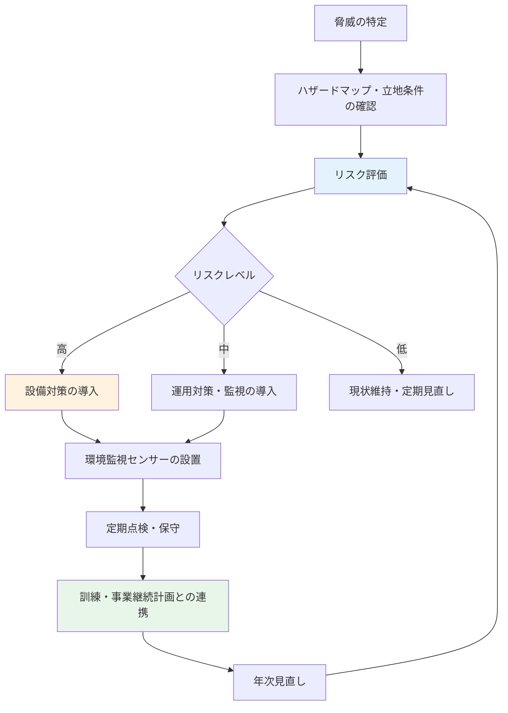

# A.7.5 物理的および環境的脅威からの保護

## 管理策の概要

| 項目 | 内容 |
|------|------|
| 管理策タイプ | 予防的 |
| 情報セキュリティ特性 | 機密性、完全性、可用性 |
| サイバーセキュリティ概念 | 防御 |
| 運用能力 | 物理的セキュリティ |
| セキュリティドメイン | 保護 |

## 目的

自然災害や、意図的・偶発的な物理的脅威（火災、水害、地震、停電等）によるインフラへの損害を防ぐための保護対策を設計し、実装します。物理的・環境的脅威は、情報そのものだけでなく、情報を処理する設備や拠点全体の可用性に大きな影響を与えます。拠点の立地や施設の特性を踏まえてリスクを評価し、計画的に対策を講じることが重要です。

## 実施のポイント

### 物理的・環境的脅威の特定

まず、自組織の拠点がどのような脅威に晒されているかを洗い出します。脅威は自然災害だけでなく、人為的なものも含めて幅広く検討します。

| 脅威の分類 | 例 | 主な影響 |
|------------|-----|----------|
| 自然災害 | 地震、台風、水害、落雷、大雪 | 建物・設備の損壊、長時間の業務停止 |
| 火災 | 近隣火災、施設内の失火、電気火災 | 設備の焼損、記録媒体の喪失 |
| 水漏れ | 配管の破損、空調ドレンの詰まり、上階からの漏水 | 機器の故障、漏電 |
| インフラ障害 | 停電、空調故障、通信回線の切断 | システム停止、機器の過熱 |
| 人為的脅威 | 破壊行為、周辺での騒乱・事故 | 設備の損壊、拠点への立入不能 |

脅威の特定にあたっては、自治体が公開するハザードマップや、ビル管理会社からの情報（耐震性能、非常用電源の有無等）も活用します。

### リスク評価と対策導入の流れ

特定した脅威ごとに発生可能性と影響度を評価し、優先順位を付けて対策を導入します。導入後も監視・点検・見直しを継続するサイクルを回します。



### 脅威別の保護対策

脅威ごとに「予防」と「検知・対応」の両面から対策を整備します。

| 脅威 | 予防対策 | 検知・対応策 |
|------|----------|--------------|
| 火災 | 可燃物の持込制限、電源タップ・配線の定期点検 | 煙感知器、消火器・消火設備の設置 |
| 水漏れ | サーバールームを水回りから離して配置、機器のラック搭載 | 漏水センサー、緊急時の電源遮断手順 |
| 地震 | ラック・棚の固定、転倒防止器具、耐震性のあるビルの選定 | 発生後の損傷点検手順、安否確認 |
| 停電 | UPS の設置、ビル非常用電源の給電範囲の確認 | 電源監視、自動シャットダウン設定 |
| 空調障害・過熱 | 空調の冗長化、定期保守 | 温湿度センサー、閾値超過時のアラート |

本番環境をクラウドで運用している場合でも、オフィス内のサーバールームやネットワーク機器、書庫などは自組織で保護する必要があります。

### 環境監視と定期点検

対策は導入して終わりではなく、継続的な監視と点検によって有効性を維持します。

- **環境監視センサー**: 温度・湿度・漏水・煙などを常時監視し、閾値を超えた場合は担当者へ自動通知する
- **定期点検**: 消火設備、UPS、空調、転倒防止器具などを定期的に点検し、記録を残す
- **是正対応**: 点検で見つかった不備は期限を決めて改善し、完了を確認する

### 事業継続との連携

物理的・環境的脅威は、対策を講じても完全には防げません。被害が発生した場合に重要業務を継続・復旧できるよう、[事業継続計画](/isms/plans/business-continuity-plan)と連携させます。

1. **想定インシデントの整合**: BCP が想定する自然災害・停電等のシナリオと、本管理策で特定した脅威を一致させる
2. **復旧優先順位の共有**: 重要システムの目標復旧時間（RTO）を踏まえ、保護対策の優先度を決める
3. **代替手段の確保**: DR 環境（別リージョン等）への切替手順や、代替勤務場所（リモートワーク）を整備する
4. **訓練への組込み**: 避難訓練や事業継続訓練に、物理的脅威のシナリオを組み込む

## 実装例

### 物理的・環境的脅威対策基準

```yaml
物理的・環境的脅威対策基準:

  対象拠点:
    - 本社（シーサイドビル 8F）
    - 福岡開発センター（テックビル 5F）

  本社サーバールーム:
    火災対策:
      - 煙感知器の設置（ビル防災設備と連動）
      - 消火器の設置（年1回点検）
      - 可燃物（段ボール等）の持込禁止
    水害対策:
      - 漏水センサーの設置（空調ドレン付近）
      - 機器はすべてラック搭載（床への直置き禁止）
    地震対策:
      - サーバーラックの床固定
      - 転倒防止ベルト・耐震マットの使用
    電源対策:
      - UPS の設置（停電時の自動シャットダウン連動）
      - ビル非常用電源の給電範囲を管理会社に確認
    空調対策:
      - 専用空調2系統による冗長化
      - 温湿度センサーによる常時監視

  福岡開発センター:
    方針: ローカルサーバーなしのため、オフィス一般対策を適用
    対策:
      - 消火器の設置場所の周知
      - 書庫・棚の転倒防止固定
      - ハザードマップの確認（年1回）

  運用体制:
    対策の導入・保守: インフラ部
    点検記録の管理: 総務部
    承認: セキュリティ担当 田中
```

### 環境監視センサー設定

```yaml
環境監視設定:

  対象: 本社サーバールーム

  センサーと閾値:
    温度:
      正常範囲: 18〜27℃
      警告: 28℃以上で通知
      重大: 32℃以上で通知・緊急対応
    湿度:
      正常範囲: 40〜60%
      警告: 範囲外で通知
    漏水:
      検知時: 即時通知、電源遮断の要否を判断
    煙:
      検知時: ビル防災設備への自動通報

  通知先:
    警告: インフラ部チャットチャンネル
    重大: インフラ部オンコール担当 + 総務部

  記録:
    監視ログ保存期間: 1年間
    アラート対応記録: 対応完了まで記録し、月次で振り返り
```

### 設備点検記録テンプレート

| 項目 | 記録内容 |
|------|----------|
| 点検日 | 2025-02-10 |
| 対象設備 | サーバールーム UPS、消火器、漏水センサー |
| 点検者 | 山田太郎（インフラ部） |
| 点検内容 | UPS バッテリー状態確認、消火器の有効期限確認、漏水センサーの動作テスト |
| 結果 | UPS 正常、消火器は有効期限内、センサー正常 |
| 指摘事項 | 空調2号機のフィルター汚れ → 次回保守時に交換 |
| 是正期限 | 2025-03-31 |
| 確認者 | 鈴木一郎 |
| 承認 | 佐藤部長 |

## 関連する管理策

- [A.7.1 物理的セキュリティ境界](/controls/a-7-1) - 保護対象となる領域・境界の定義
- [A.7.8 装置の設置及び保護](/controls/a-7-8) - 装置単位での環境的脅威からの保護
- [A.5.29 事業の中断・阻害時の情報セキュリティ](/controls/#a-5-29) - 中断・阻害時のセキュリティ維持
- [A.5.30 事業継続のためのICTの備え](/controls/a-5-30) - 被災時に ICT を継続するための備え

## 参考情報

- [事業継続計画](/isms/plans/business-continuity-plan) - 物理的脅威を想定インシデントに含む BCP テンプレート
- [仮想組織の設定 - 拠点情報](/templates/virtual-organization#拠点情報) - 拠点・設備構成の前提
