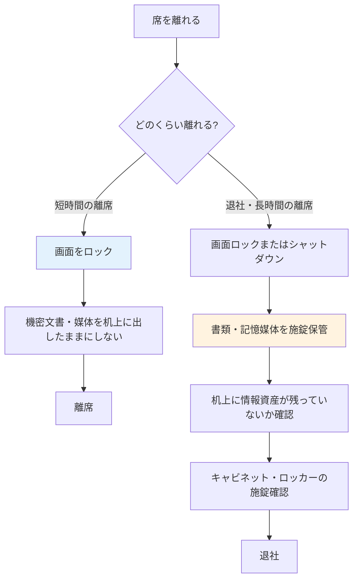

# A.7.7 クリアデスクとクリアスクリーン

## 管理策の概要

| 項目 | 内容 |
|------|------|
| 管理策タイプ | 予防的 |
| 情報セキュリティ特性 | 機密性 |
| サイバーセキュリティ概念 | 防御 |
| 運用能力 | 物理的セキュリティ |
| セキュリティドメイン | 保護 |

## 目的

紙媒体やリムーバブル記憶媒体に対するクリアデスク規則と、情報処理設備に対するクリアスクリーン規則を定め、適切に実施します。机上や画面に放置された情報は、来訪者・清掃業者・他部門の従業員など、本来アクセス権限のない者の目に触れたり、持ち去られたりするリスクがあります。離席時・退社時に情報が放置されない状態を組織の習慣として定着させることで、日常業務に潜む情報漏洩リスクを低減します。

## 実施のポイント

### クリアデスク規則の策定

机上やその周辺に放置されやすい情報資産を洗い出し、対象物ごとに取扱いルールを定めます。

| 対象物 | ルール |
|--------|--------|
| 機密文書・帳票 | 離席時・退社時は施錠可能なキャビネットへ保管 |
| リムーバブル記憶媒体（USBメモリ等） | 使用後は速やかに施錠保管、机上への放置禁止 |
| 付箋・手書きメモ | パスワード・アカウント情報の書き残し禁止 |
| 印刷物 | 出力後は速やかに回収、プリンターへの放置禁止 |
| ホワイトボード | 会議終了時に消去、機密情報の書き残し禁止 |
| 不要になった書類 | シュレッダーまたは機密文書回収ボックスで廃棄 |

### クリアスクリーン規則の策定

画面に表示された情報を保護するため、以下のルールを定めます。

1. **手動ロックの徹底**: 離席時は必ず画面をロックする（ショートカットキーを周知）
2. **自動ロックの強制**: 一定時間（例: 10分）無操作で自動的に画面ロックする設定を全端末に適用
3. **ロック解除の認証**: 画面ロック解除時にパスワード等の認証を必須とする
4. **画面の配置**: 来訪者の動線から画面が見えない向きにモニターを配置
5. **のぞき見対策**: 社外・リモートワークでの作業時はプライバシーフィルターを使用

自動ロックの設定は個人任せにせず、MDM やグループポリシーで組織的に強制することが重要です。

### 離席・退社時の手順

従業員が迷わず実践できるよう、離席の場面ごとに手順を整理して周知します。



### 共用設備・共用エリアへの展開

クリアデスク・クリアスクリーンは個人の机だけでなく、情報が放置されやすい共用設備にも適用します。

- **プリンター・複合機**: 認証印刷（ICカードをかざして出力する方式）の導入により、印刷物の放置を仕組みで防止
- **会議室**: 退室時のホワイトボード消去と配付資料の回収を、会議主催者の責任として明確化
- **フリーアドレス席**: 退社時に机上へ何も残さない運用とし、書類・私物は個人ロッカーへ保管
- **リモートワーク環境**: 家族等の同居者からも画面・書類が見えないよう、作業環境のルールを定める

### 遵守状況の点検

規則は策定して終わりではなく、定期的に遵守状況を確認し、形骸化を防ぎます。

| 点検方法 | 頻度 | 実施者 |
|----------|------|--------|
| 執務エリアの巡回点検 | 月1回 | ISMS事務局・部門セキュリティ担当者 |
| 退社後の机上抜き打ち確認 | 四半期に1回 | ISMS事務局 |
| 画面ロック設定の技術的確認 | 月1回（MDMで自動集計） | 情報システム担当 |
| 内部監査での確認 | 年1回 | 内部監査チーム |

点検結果は記録し、指摘が多い部門には再教育を実施するなど、意識向上の取り組みと連動させます。

## 実装例

### クリアデスク・クリアスクリーン規程（例）

```yaml
クリアデスク・クリアスクリーン規程:

  適用範囲:
    対象者: 全従業員（派遣社員・常駐の業務委託要員を含む）
    対象場所: 本社、福岡開発センター、リモートワーク環境

  クリアデスク:
    執務エリア（フリーアドレス）:
      - 退社時は机上に書類・記憶媒体・私物を一切残さない
      - 書類・記憶媒体は個人ロッカーに施錠保管
      - 機密レベル「秘密」以上の書類は総務部管理の施錠キャビネットに保管
    会議室:
      - 退室時にホワイトボードを消去
      - 配付資料・メモの回収を会議主催者が確認
    プリンター:
      - 認証印刷を導入（ICカードをかざして出力）
      - 出力した印刷物は速やかに回収

  クリアスクリーン:
    手動ロック:
      タイミング: 離席時は必ず実施
      操作方法: Windows は Win+L、Mac は Control+Command+Q
    自動ロック:
      設定: 10分間無操作で画面ロック
      適用方法: MDMで全端末に強制適用（個人での変更不可）
    画面の保護:
      - モニターは来訪者の動線から見えない向きに配置
      - 社外・リモートワーク時はのぞき見防止フィルターを使用

  リモートワーク時の追加ルール:
    - 同居者から画面・書類が見えない環境で作業する
    - 機密情報は原則印刷しない（やむを得ず印刷した場合は使用後シュレッダー処分）
    - 業務終了後は会社システムからログアウトする

  違反時の対応:
    初回: 口頭での注意と是正
    繰り返し: 部門セキュリティ担当者から上長へ報告、再教育を実施
```

### クリアデスク巡回点検記録テンプレート

| 項目 | 記録内容 |
|------|----------|
| 点検日 | 2025-01-31 |
| 点検者 | 田中（ISMS事務局） |
| 対象エリア | 本社8F 執務エリア |
| 点検結果 | 指摘2件 |
| 指摘事項1 | 机上に顧客向け提案書が放置（対応: 山田太郎が回収し施錠保管） |
| 指摘事項2 | プリンターに印刷物が放置（対応: 鈴木一郎に注意、本人が回収） |
| 是正確認 | 佐藤部長が当日中に是正完了を確認 |
| 特記事項 | 認証印刷の導入後、印刷物の放置は減少傾向 |

### 画面ロック設定の確認記録（例）

```yaml
画面ロック設定確認:

  確認日: 2025-01-31
  確認者: 鈴木一郎（情報システム担当）
  確認方法: MDM管理コンソールでの設定適用状況の集計

  結果:
    対象端末数: 152台
    自動ロック設定適用済み: 150台
    未適用: 2台（修理交代機、設定漏れ）

  対応:
    - 未適用2台は当日中に設定を適用
    - 交代機の貸出手順に設定確認のチェック項目を追加

  報告先: 田中（ISMS管理責任者）
```

## 関連する管理策

- [A.7.3 オフィス、部屋および施設のセキュリティ](/controls/a-7-3) - 施錠可能なキャビネット等、保管環境の物理的セキュリティ
- [A.8.1 利用者エンドポイント機器](/controls/#a-8-1) - 画面ロックを含む端末側の保護対策
- [A.6.3 情報セキュリティの意識向上、教育および訓練](/controls/#a-6-3) - クリアデスク・クリアスクリーンを習慣として定着させる教育

## 参考情報

- [情報の許容される利用方針 - 4. 禁止事項](/isms/policies/acceptable-use-policy#_4-禁止事項) - 情報資産の取扱いに関する禁止事項
- [従業員向けセキュリティガイドライン - 4.3 クリアデスク・クリアスクリーン](/isms/guidelines/employee-security-guideline#_4-3-クリアデスク・クリアスクリーン-a-7-7) - 従業員向けの具体的なルール例
- [仮想組織の設定 - 物理的環境](/templates/virtual-organization#物理的環境) - オフィスレイアウト・フリーアドレス等の前提条件
