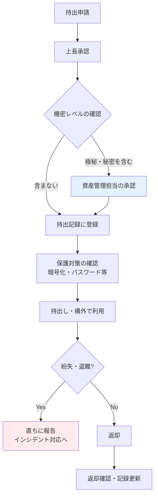

# A.7.9 構外にある資産のセキュリティ

## 管理策の概要

| 項目 | 内容 |
|------|------|
| 管理策タイプ | 予防的 |
| 情報セキュリティ特性 | 機密性、完全性、可用性 |
| サイバーセキュリティ概念 | 防御 |
| 運用能力 | 物理的セキュリティ、資産管理 |
| セキュリティドメイン | 保護 |

## 目的

オフィスの外（構外）に持ち出された資産を保護します。ノートPCや書類などの資産は、構外に出た瞬間からオフィスの物理的セキュリティ対策の保護を受けられなくなり、紛失・盗難・のぞき見などのリスクが大きく高まります。持出しの承認手続と構外での保護ルールを定め、資産の所在を追跡できる状態を維持することで、これらのリスクを低減します。

## 実施のポイント

### 対象となる資産の特定

構外に持ち出される可能性のある資産を洗い出し、管理対象を明確にします。

- ノートPC・タブレット・スマートフォン
- USBメモリ・外付けHDDなどの記憶媒体
- 紙の書類（契約書、提案書、設計書等）
- モバイルルーター・認証トークンなどの周辺機器
- リモートワーク用に従業員宅へ常時配置される機器

一時的な持出し（外出・出張）と、リモートワークのような恒常的な構外利用では管理方法が異なります。恒常的な利用については、貸与時に利用条件を明示し、定期的な棚卸しで所在を確認する方式が現実的です。

### 持出しの承認手続

資産の持出しは、事前申請と承認に基づいて行います。承認の粒度はリスクに応じて調整し、日常的な持出しまで都度申請にすると形骸化するため、包括承認と都度承認を使い分けます。

| 持出しパターン | 承認方式 | 例 |
|----------------|----------|-----|
| 貸与PCの日常的な持出し | 貸与時に包括承認 | リモートワーク、日常の外出 |
| 記憶媒体の持出し | 都度申請・承認 | 顧客先へのデータ受渡し |
| 機密書類の持出し | 都度申請・承認 | 契約書の持参 |
| 海外への持出し | 都度申請 + 追加要件の確認 | 海外出張 |

### 持出しから返却までの流れ



### 構外での保護要件

構外では、場面ごとに以下の保護ルールを適用します。

| 場面 | 保護ルール |
|------|------------|
| 移動中 | 資産は常に手元に置く。車内放置・預け入れ荷物・網棚への放置は禁止 |
| 公共の場での作業 | のぞき見防止フィルターを使用し、機密情報を扱う作業は避ける |
| 自宅での保管 | 家族を含む第三者が業務情報に触れない場所に保管し、端末を共用しない |
| 通信 | 公衆Wi-Fiでの業務は禁止（会社貸与のモバイルルーターまたはVPNを使用） |
| 技術的保護 | ディスク全体の暗号化、ログインパスワード、リモートワイプの設定を必須とする |
| 持ち出す情報 | 業務に必要な最小限の情報のみ持ち出す |

### 紛失・盗難時の対応と資産の追跡

紛失・盗難は「発生し得るもの」として、事後対応をあらかじめ準備します。

1. **即時報告**: 発見次第、時間外でも直ちに報告する窓口を周知する
2. **リモート対応**: MDM等によるリモートロック・リモートワイプを実行する
3. **被害評価**: 持出記録から、失われた資産と含まれる情報を特定する
4. **外部対応**: 警察への届出、必要に応じて顧客・関係者への連絡を行う

また、持出記録とMDMの登録情報を定期的な資産棚卸しと照合し、所在不明の資産がないかを確認します。返却されないまま放置された資産は紛失と区別がつかなくなるため、長期間返却記録のない持出しは定期的に洗い出してフォローします。

## 実装例

### 資産持出申請書

```yaml
資産持出申請:

  申請者情報:
    氏名: 山田太郎
    所属: 営業部
    社員番号: EMP001

  持出資産:
    - 資産名: 貸与ノートPC
      資産番号: PC-0123
      含まれる情報: 顧客提案書（社外秘）
    - 資産名: 暗号化USBメモリ
      資産番号: USB-0045
      含まれる情報: デモ環境データ（社外秘）

  持出情報:
    持出先: 顧客A社（大阪市）
    持出期間: 2025-01-27 〜 2025-01-28
    目的: 製品デモンストレーションの実施

  保護対策の確認:
    - ディスク暗号化: 有効
    - リモートワイプ: 設定済み
    - のぞき見防止フィルター: 装着済み

  承認:
    上長: 佐藤部長（承認済）
    資産管理担当: 田中（承認済）
```

### 持出記録テンプレート

| 持出日 | 資産番号 | 資産名 | 持出者 | 持出先 | 返却予定日 | 返却日 | 確認者 |
|--------|----------|--------|--------|--------|------------|--------|--------|
| 2025-01-27 | PC-0123 | ノートPC | 山田太郎 | 顧客A社 | 2025-01-28 | 2025-01-28 | 田中 |
| 2025-01-27 | USB-0045 | 暗号化USBメモリ | 山田太郎 | 顧客A社 | 2025-01-28 | 2025-01-28 | 田中 |
| 2025-01-29 | PC-0150 | ノートPC | 鈴木一郎 | 自宅（リモートワーク） | 包括承認 | - | 田中 |

### 紛失・盗難時対応手順

```yaml
紛失・盗難時対応手順:

  従業員の初動:
    - 発見次第、直ちにISMS管理責任者へ報告（夜間・休日も連絡）
    - 紛失した場所・時刻・状況を可能な範囲で整理
    - 心当たりのある場所・施設へ確認

  情報システム部門の対応:
    - MDMによるリモートロック・リモートワイプの実行
    - 該当アカウントのパスワードリセット・セッション無効化
    - アクセスログの確認（不正利用の有無）

  資産管理担当の対応:
    - 持出記録から資産と含まれる情報の特定
    - 機密レベルに応じた影響評価
    - 警察への遺失物届・盗難届の提出支援

  事後対応:
    - インシデント報告書の作成
    - 必要に応じて顧客・関係者への連絡
    - 再発防止策の検討（持出ルールの見直し等）
```

## 関連する管理策

- [A.6.7 リモートワーク](/controls/#a-6-7) - 恒常的な構外利用であるリモートワークのセキュリティ
- [A.8.1 利用者エンドポイント機器](/controls/#a-8-1) - 持ち出される端末そのものの保護
- [A.5.9 情報およびその他の関連資産の目録](/controls/#a-5-9) - 持出し対象資産の特定の前提となる資産目録
- [A.7.10 記憶媒体](/controls/a-7-10) - 記憶媒体の輸送・持出し時の保護

## 参考情報

- [従業員向けセキュリティガイドライン - 4.7 構外での資産管理](/isms/guidelines/employee-security-guideline#_4-7-構外での資産管理-a-7-9) - 従業員向けの持出しルール
- [仮想組織の設定 - リモートワーク環境](/templates/virtual-organization#リモートワーク環境) - 構外利用の前提となる環境設定の例
